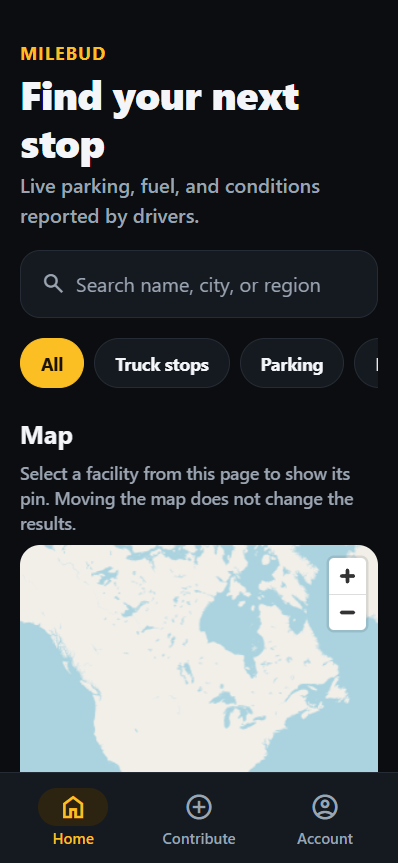
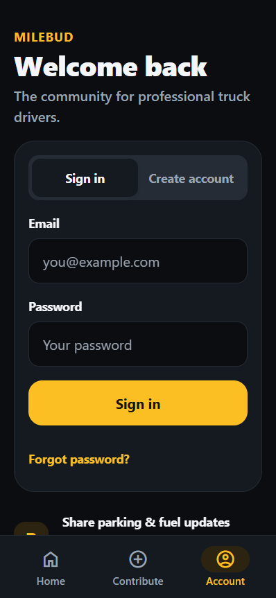

# Milebud

Milebud is a work-in-progress mobile app for professional truck drivers to discover facilities and share timely updates about conditions on the road. It is built with Expo, React Native, TypeScript, and Supabase, with a web version for development and testing.

## Screenshots

| Discover | Account |
| :---: | :---: |
|  |  |

Screenshots show the signed-out web experience at a mobile viewport. Map data &copy; [OpenStreetMap contributors](https://www.openstreetmap.org/copyright).

## What is available

- Search and filter approved facilities, browse pages of results, and view facility details and listed amenities.
- Explore an OpenStreetMap map and show the location of a selected facility from the current results page.
- Read expiring driver reports and, when signed in, share updates or confirm and dispute reports.
- Create an account, sign in, recover a password, and edit profile information.
- Suggest facilities and track the status of your submissions.

The map does not yet search by map bounds or show all facilities at once. Facility coverage depends on approved data in your Supabase project. Nearby search, directions, and broader moderation workflows are still planned. Moderation migrations need validation in an isolated hosted development project before deployment.

### Facility moderation

The proposed automatic review approves a suggestion only when its name, type, country, address, city, and coordinates match exactly one current trusted-place record, no existing facility is within 200 metres, and the submitter has made no more than five suggestions in the past hour. Coordinates must be within 75 metres of the trusted record. The published record uses trusted data, not unverified contact details. All other suggestions remain pending for human review; the hourly check limits automatic approvals, not submissions.

Trusted-place records must be independently verified and populated by a database administrator from a source with suitable permission and attribution. They expire and are not writable or readable by app users. **No source is configured or imported automatically**, so auto-approval will not work until trusted records are provisioned. The checks cannot guarantee accuracy or eliminate abuse, and manual duplicate checks and corrections remain important. Decisions are recorded in a private audit table.

Neither moderation migration has been deployed to the linked production database. Test both migrations and their SQL tests in a separate hosted development project before deployment. See [implementation progress](MILEBUD_PROGRESS.md) for the current status.

## Getting started

### Prerequisites

- Node.js and npm.
- A Supabase project with the required schema and authentication configured.
- Expo Go, a development build, or a browser to run the app.

### Install and configure

```sh
npm install
```

Copy `.env.example` to `.env` and set `EXPO_PUBLIC_SUPABASE_URL` and `EXPO_PUBLIC_SUPABASE_PUBLISHABLE_KEY` to your project's public URL and publishable key. These variables are bundled into the client and are **not secrets**. Never put a service-role or secret key in them. `.env` is ignored by Git.

The database schema is defined in [`supabase/migrations`](supabase/migrations). Apply and test migrations against a separate hosted development project before deploying them to production; this project does not require local Docker. Email confirmation and password recovery also require the app callback and deployed web URL to be allowed in Supabase Auth's redirect settings.

### Run

```sh
npx expo start
```

Use the Expo CLI to open the app in Expo Go, a development build, or a browser. To start directly on the web:

```sh
npm run web
```

### Checks

```sh
npx expo lint
npx tsc --noEmit
```

Database security tests live in [`supabase/tests`](supabase/tests). Tests that create or modify records must run only against an isolated hosted development database, never the production project.

## Project documentation

- [Product specification](MILEBUD_PRODUCT_SPEC.md)
- [Roadmap](MILEBUD_ROADMAP.md)
- [Implementation progress and verification](MILEBUD_PROGRESS.md)

The map uses OpenStreetMap's embedded service. Requests and selected public facility coordinates are sent to OpenStreetMap; its donated tile service has [usage limits and no availability guarantee](https://operations.osmfoundation.org/policies/tiles/).
